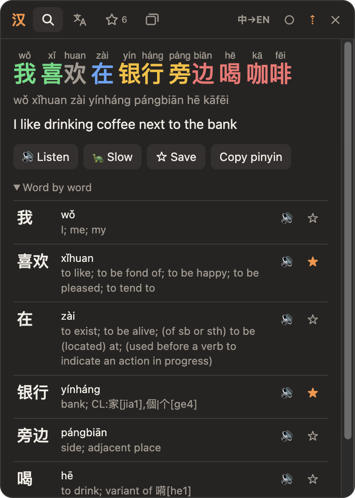
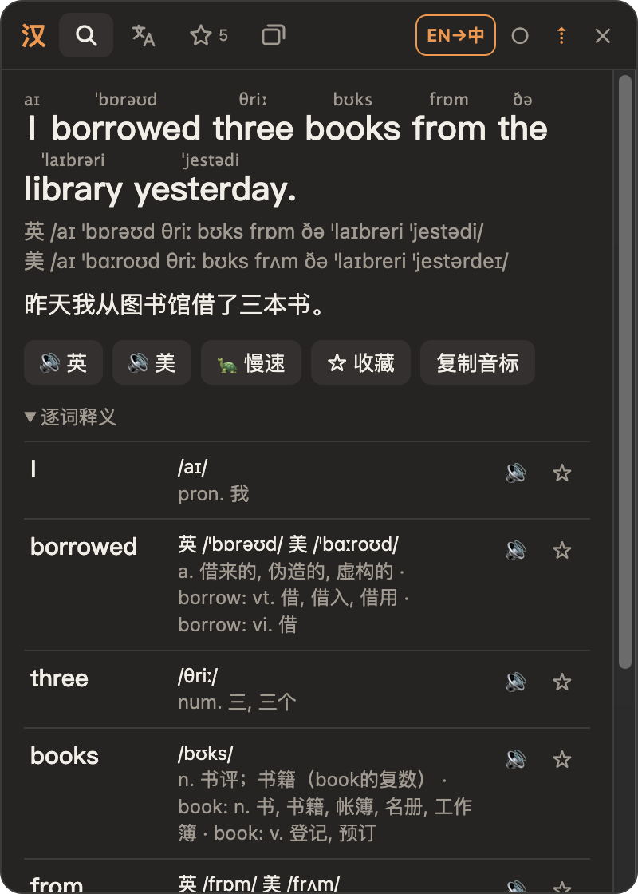
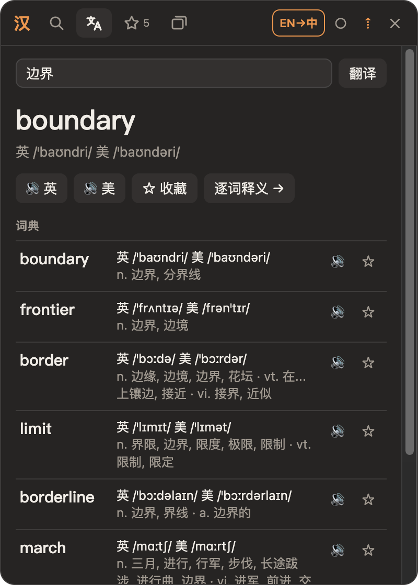
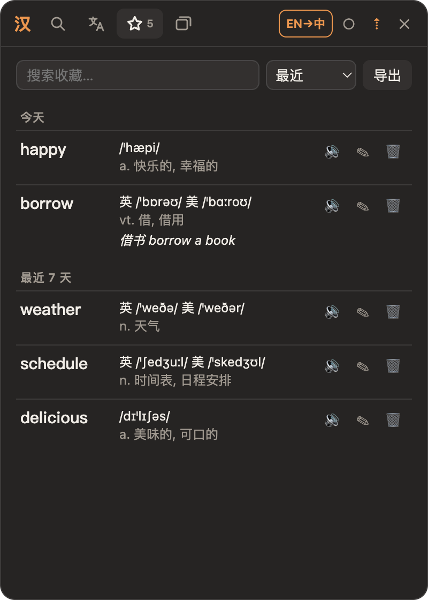
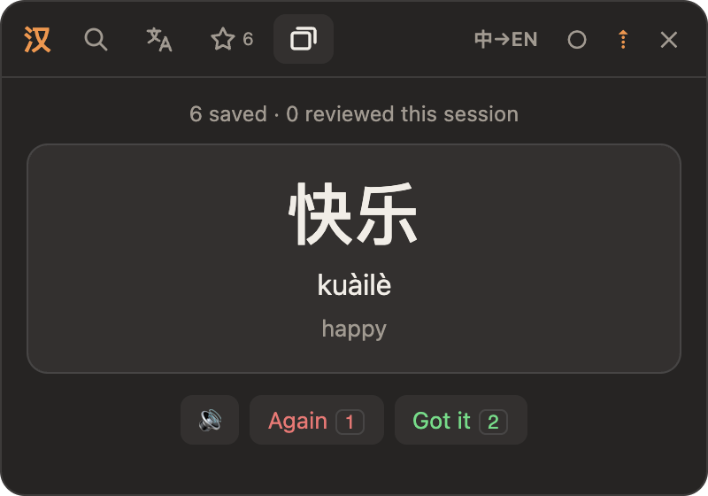
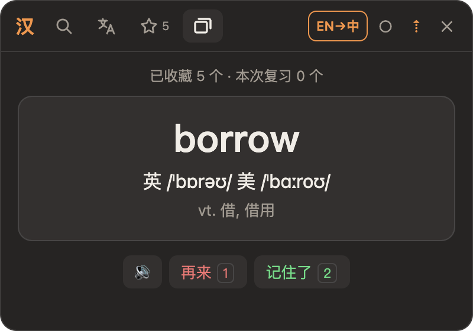

# Hanzi Buddy 汉

A small floating, always-on-top macOS card for learning a language from whatever you're reading. It works both ways and picks the direction by itself:

- **Learning Chinese (中→EN).** Copy or highlight Chinese and you get tone-colored pinyin, an English translation, word-by-word meanings, read-aloud, and a saved list with flashcard review.
- **学英语 (EN→中).** The mirror for Chinese speakers learning English. Copy or highlight English and you get British and American 音标 (in the modern IPA of today's textbooks) above each word, a Chinese translation, word-by-word Chinese meanings, British and American read-aloud, and its own saved list and review. The UI is in Chinese.

<p>
  
  
</p>

## Run

```bash
nvm use            # Node 26 (see .nvmrc)
npm install        # also downloads the dictionaries into data/ (see "Data" below)
npm start          # builds and launches
```

The app lives in the menu bar as **汉** (no Dock icon). The card is always either on screen or in hidden mode: closing it (✕) switches to hidden mode. Bring it back with **▣** in the popup or **Show card** in the 汉 menu, or quit from there.

The tabs are icons (hover for a tooltip): 🔍 Lookup · 文A Translate (type the language you know) · ☆ Saved (with a count) · ▭ Review flashcards. On the right of the header: the mode (**中→EN** / **EN→中**), ● clipboard watching, ⇡ always on top, and ✕.

## Two modes, chosen by what you select

Copy or highlight Chinese and the card switches to Learning Chinese. Copy or highlight English and it switches to 学英语. You can also switch by hand with the **中→EN / EN→中** button or in the 汉 menu. The card opens in the mode you used last.

| | **Learning Chinese** (中→EN) | **学英语** (EN→中) |
|---|---|---|
| Opens for | Text with Chinese characters | English: Latin letters, no Chinese. Links, emails and file paths are skipped. |
| Above each word | Pinyin, colored by tone | 音标 in the accent you picked last with 🔊 英 / 🔊 美 |
| Phrase line | `wǒ xǐhuan hē kāfēi` | `英 /aɪ laɪk ˈkɒfi/` and `美 /aɪ laɪk ˈkɑːfi/` |
| Translation | English | Chinese |
| Word by word | CC-CEDICT English meanings | ECDICT Chinese meanings; inflections also show the base word (went → go) |
| Read aloud | 🔊 Listen · 🐢 Slow (Tingting) | 🔊 英 (Daniel, British) · 🔊 美 (Samantha, American) · 🐢 慢速 (the accent you picked last) |
| 文A Translate tab | Type English → Chinese with pinyin | Type Chinese → English with 音标 |
| Saved / Review | Your Chinese words (`saved.json`) | A separate list of English words (`saved-en.json`) |
| UI language | English | Chinese |

<p>
  
  
</p>

## Using it

- **Copy** Chinese or English text (≤300 chars) and the card updates and switches to the right mode. Toggle with the ● button or **Watch clipboard** in the menu bar. Items password managers mark as concealed are ignored.
- **Highlight + ⌘⇧Y** grabs selected text without you copying it. The first time, macOS asks you to allow the app (shows as *Electron* while in dev) under System Settings → Privacy & Security → Accessibility. Your clipboard is restored afterward, including images, files and rich text. Pick a different hotkey under **Hotkey** in the 汉 menu.
- **文A tab**: type the language you know and press Enter. Learning Chinese: English in, Chinese with pinyin out. 学英语: Chinese in, English with 音标 out. While you type a word or short phrase, it also lists matching words from the offline dictionary, so that part works without internet. Matches come in order of how central the meaning is to each word, then how common the word is: 边界 gives boundary, frontier, border, limit before march, where 边界 is only the seventh meaning. *Word by word →* opens the answer in Lookup. Typing the language you're learning here opens it in Lookup instead.
- **Double-tap ⌃ Control** from any app opens the 文A tab with the text box focused (in hidden mode, as a popup at the mouse). Type, press Enter. Double-tap again, or press Esc on an empty box, to go back to the app you were in. In card mode the card stays on screen. Pick ⇧⇧, ⌘⇧E or Off under **Translate shortcut** in the 汉 menu. (⌥⌥ isn't offered because Claude's quick-chat box uses it.) Needs the same Accessibility permission as the hotkey.
- **☆ Save** the phrase, or ☆ individual words in *Word by word* or the dictionary list. Removing a saved item asks you to click twice, because its note and review history go with it.
- **Saved**: sort by **Recent**, **A–Z** (pinyin for Chinese, the word for English) or **Needs practice**, search (tone marks optional: `xihuan` finds 喜欢), add notes (✎), delete, and **Export** to CSV (Anki-importable).
- **Review**: flashcards. Click or press Space to reveal, then **1** = Again / 再来, **2** = Got it / 记住了. Missed words come up more often.

<p>
  
  
</p>

### 音标

Written the way current Chinese textbooks and the Oxford/Cambridge learner's dictionaries write them, with British and American side by side:

| | Britain 英 | America 美 |
|---|---|---|
| border | /ˈbɔːdə/ | /ˈbɔːrdər/ |
| go | /ɡəʊ/ | /ɡoʊ/ |
| library | /ˈlaɪbrəri/ | /ˈlaɪbreri/ |
| hot | /hɒt/ | /hɑːt/ |

- **British** comes from [Britfone](https://github.com/JoseLlarena/Britfone) for about 14,900 common words. Other words use ECDICT's 音标, converted from its older notation (`go ɡou`, `I ai`, `sit sit`) to modern IPA (`ɡəʊ`, `aɪ`, `sɪt`).
- **American** comes from the [CMU Pronouncing Dictionary](https://github.com/cmusphinx/cmudict), converted from its letter codes (`B AO1 R D ER0`) to IPA.
- Stress is marked at the start of the stressed syllable (ˈbɔːdə), not on the vowel. One-syllable words and weak stress after the main stress (ˈbɒrəʊd, not ˈbɒˌrəʊd) carry no mark, as in learner's dictionaries.
- When a word has two pronunciations (construct: ˈkɒnstrʌkt n. / kənˈstrʌkt v.), the one stressed like ECDICT's is used, so it fits the meanings shown.
- The converters are in `src/shared/pronunciation.ts`, with tests built from real lines of each source in `test/pronunciation.test.ts`.

### Where the English data falls short

- Regular plurals and past forms a source has no 音标 for (books, watches) get it from the base word plus the standard ending: -s as /s/ /z/ /ɪz/, -ed as /t/ /d/ /ɪd/.
- 11,142 of the 92,163 entries have no British 音标, and 24,502 have no American 音标, mostly rare words and inflections. They show with what's known, or none, rather than being dropped.
- Specialist meanings such as `[计]` (computing) or `[医]` (medicine) are hidden when a word has everyday ones.
- Google's free endpoint sometimes misspells a single word (快乐 → "hapiness"). In 学英语, a one-word answer the dictionary doesn't know is replaced by the top dictionary match.

## Hidden mode

No window at all. Turn it on with **✕** in the card header or **Hidden mode** in the 汉 menu (switch back with **▣** in the popup or the same menu item).

- Highlight Chinese or English anywhere. The menu bar changes to **汉 ⌘⇧Y** to show it's ready.
- Press **⌘⇧Y** to open a popup next to your mouse, in the mode that matches the text (save, listen, Saved/Review tabs all work).
- **Esc**, ⌘⇧Y again, or clicking anywhere else closes it and returns focus to the app you were reading in.
- Copying text doesn't open anything in hidden mode; only the hotkey does.

Highlights are read by a small native helper (`native/selection-watcher.c`, compiled to `bin/` on build) through the macOS Accessibility API. It only passes along selections containing Chinese or English (not links) and never reads password fields. The app then decides the mode from the text (`detectLang()` in `src/main/lookup.ts`). For Chrome-family browsers it turns on Chrome's accessibility support (the same flag screen readers use) so page selections are readable. This can slow Chrome on heavy pages, and may last until you restart Chrome, even after quitting Hanzi Buddy. If an app doesn't expose its selection, ⌘⇧Y falls back to sending ⌘C through `native/clipboard-grab.m`. Debug the helper with `SELECTION_WATCHER_DEBUG=1 ./bin/selection-watcher`.

The translate shortcut uses `native/modifier-tap.c`, a listen-only event tap. It prints only `tap` (the modifier pressed and released on its own) and `cancel` (something else happened right after a tap). It never reports which keys you type, and the app decides what counts as a double tap (`src/main/double-tap.ts`). Debug it with `MODIFIER_TAP_DEBUG=1 ./bin/modifier-tap control`.

## Privacy

Phrase translation sends the text you look up to Google Translate and MyMemory. With **Watch clipboard** on, that includes any Chinese or English text you copy, so you may want to pause watching (●) while copying private English text. Text you type in the 文A tab is sent when you press Enter (the dictionary matches shown while typing stay on your Mac). Nothing is sent until you answer the notice on first launch, and you can switch it off any time with **Online translation** in the 汉 menu. Pronunciation, word meanings, speech and your saved words stay on your Mac.

## Data

Both dictionaries are external datasets, registered in [`data/datasets.csv`](data/datasets.csv) (source, licence, version, size, checksum) and downloaded by `npm install` (`scripts/fetch-dict.mjs`). Neither is committed to git. Facts about them are in [`data/facts/facts_v1.csv`](data/facts/facts_v1.csv).

| Dataset | Licence | Used for | Files |
|---|---|---|---|
| [CC-CEDICT](https://www.mdbg.net/chinese/dictionary?page=cc-cedict) | CC BY-SA 4.0 | Chinese word segmentation and English meanings | `data/cedict.txt` |
| [ECDICT](https://github.com/skywind3000/ECDICT) | MIT | English words, Chinese meanings, inflections, frequency; 音标 for words the next two don't cover | `data/raw/ecdict/ecdict.csv` (66 MB, commit `39cfb96`) |
| [Britfone](https://github.com/JoseLlarena/Britfone) | MIT | British 音标 for ~16,000 common words | `data/raw/britfone/britfone.main.3.0.1.csv` (433 KB, commit `1062be1`) |
| [CMU Pronouncing Dictionary](https://github.com/cmusphinx/cmudict) | BSD-style | American 音标 (126,052 words) | `data/raw/cmudict/cmudict.dict` (3.6 MB, commit `7479086`) |

Every download is pinned to a commit and checked against its registered checksum before it's saved.

The raw files are never edited. `data/scripts/build-english.mjs` combines them into the app's word list, `data/processed/english.tsv` (8.8 MB, British and American 音标 in separate columns). It slims ECDICT: about 58,000 common words (those with a frequency rank, an exam tag such as 中考/高考/CET-4, Oxford 3000 or Collins stars), their inflections, and 847 common phrases of up to 3 words (like "a lot"). That's 92,163 entries in all. Then it adds the 音标 described above. Rebuild it with `node --disable-warning=MODULE_TYPELESS_PACKAGE_JSON data/scripts/build-english.mjs`; the script imports the TypeScript converters directly, which Node 26 runs as is, and the flag only silences Node's notice about that. The `.dmg` ships only `cedict.txt`, `english.tsv` and the three licences.

## How it works

| Piece | Source |
|---|---|
| Pinyin (context-aware: 银行 háng / 行走 xíng) | `pinyin-pro`, offline |
| Chinese word segmentation (fewest words, then most even lengths) + meanings | CC-CEDICT, offline (`Dictionary` in `src/main/lookup.ts`) |
| English words → 音标 + Chinese meanings, matching the 847 common phrases (like "a lot") first | The combined word list, offline (`EnglishDictionary.lookup()` in `src/main/english.ts`) |
| 音标 conversion (old ECDICT notation, Britfone symbols, CMUdict codes → modern IPA) | `src/shared/pronunciation.ts` |
| Typing-tab dictionary matches | English → Chinese: CC-CEDICT meanings searched in reverse (`Dictionary.english()`). Chinese → English: ECDICT meanings searched in reverse (`EnglishDictionary.chinese()`) |
| Phrase translation (both directions) | Google Translate free endpoint (unofficial, no key); MyMemory (free, ~5000 chars/day) is also asked if Google is slow (>1.5s) or fails. Without internet you still get pronunciation + word meanings. |
| Which mode a selection opens | `detectLang()` in `src/main/lookup.ts` |
| UI text in both languages | `src/renderer/i18n.ts` |
| Speech | macOS `say`: Tingting (Chinese), Daniel (British), Samantha (American) |
| Your data | `~/Library/Application Support/Hanzi Buddy/` (`saved.json`, `saved-en.json`, `settings.json`) |

## Code

```
src/main/      main.ts (window, modes, tray, hotkeys, IPC) · lookup.ts (Chinese) · english.ts (English)
               capture.ts · selection.ts · double-tap.ts · speech.ts · storage.ts · test-lookup.ts (CLI)
src/shared/    types.ts (settings, HanziApi) · hotkey.ts (hotkey choices and labels) · saved-order.ts (Saved sorting/grouping)
               pronunciation.ts (音标 converters, also used by data/scripts/build-english.mjs)
src/preload/   preload.ts — typed bridge (HanziApi in src/shared/types.ts)
src/renderer/  index.html · styles.css · app.ts · i18n.ts (UI text for both modes)
native/        selection-watcher.c — highlight watcher for hidden mode · modifier-tap.c — double-tap ⌃ watcher
               clipboard-grab.m — ⌘C that restores the clipboard
data/          datasets.csv · facts/ · scripts/build-english.mjs (raw/ and processed/ are downloaded and built, not committed)
test/          lookup, english, pronunciation, storage, selection, double-tap and saved-order tests
docs/          screenshots for this README
```

- `npm run typecheck` runs `tsc --noEmit`; the build uses esbuild (`scripts/build.mjs`), which also compiles the native helpers into `bin/` when their source changes.
- `npm test` runs the tests (needs the dictionaries from `npm install`).
- `npm run dist` builds `release/Hanzi Buddy-*.dmg` for this Mac's architecture. It's ad-hoc signed, not notarized, so other Macs will warn on first open and macOS may ask for Accessibility again after each new build.
- `npm run test:lookup -- 我喜欢学中文` tests the Chinese lookup pipeline from the CLI.
- `HANZI_SNAPSHOT=/some/dir npm start` saves a PNG of the card after each lookup (for debugging).
- To try changes without touching your own words and settings, run a second copy on a separate profile: `npm run build && npx electron . --user-data-dir=/tmp/hanzi-test`. Turn its hotkeys off in its 汉 menu so they don't clash with your main copy. The README screenshots were taken this way, with sample saved words.
- Window placement is isolated in `cardBounds()` and `popupBounds()` in `main.ts`, so a bottom-of-screen strip mode can be added later.
